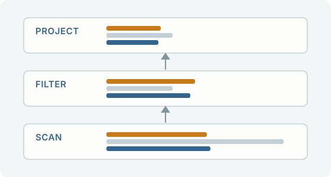

(cover)=
*Build a query engine to learn what a query costs.*

A book for data engineers who run queries every day and want to know what they cost.
Follow the steps of a query and compare what the teaching engine counts with what DuckDB
reports. The book prepares the plans and results. Read them without running code, or open an
experiment to test a prediction in your browser. The optional building path uses Python.

[Start with the preface](#preface) to choose how to work through the book.

By Chris Snow, in collaboration with Claude (Anthropic)

% number-ok: the names of the two licences, which carry their version numbers
The prose and figures use [CC BY-NC 4.0](https://github.com/snowch/query-engine-book/blob/main/LICENSE). The code uses [Apache 2.0](https://github.com/snowch/query-engine-book/blob/main/LICENSE-CODE).
